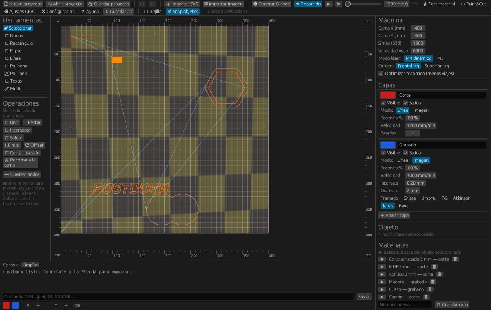
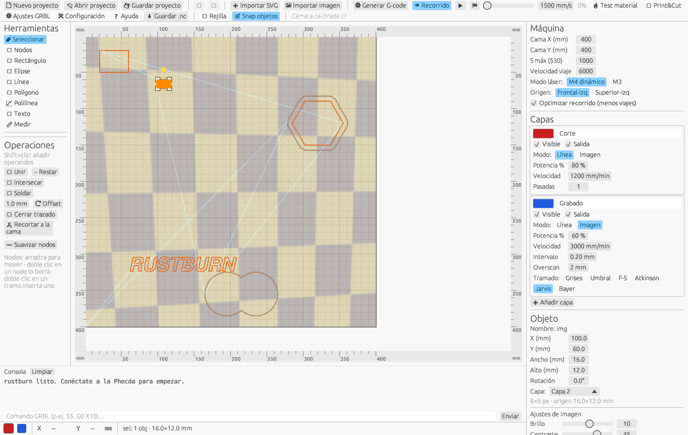

# rustburn

[Español](README.md) · **English**

A native **Rust** application for **Linux** to design and control lasers, in the style
of **LightBurn**, aimed at diode lasers running **GRBL 1.1** firmware such as the
**Elegoo Phecda 20 W**. A single binary, no runtime dependencies, no license required:
**free software**.

Immediate-mode UI with **egui/eframe**, a custom canvas, and all device I/O on a
background thread so the UI never blocks.



Optional light background (whole interface):



---

## Features

### Design and canvas
- Canvas with **zoom/pan**, a **10 mm grid**, **rulers on all four sides** and bed limits.
- **Snap** to the grid and **snap to objects** (edges/centres) with guides.
- Switchable **light or dark background** (the whole interface).
- Drawing tools: **Rectangle, Ellipse, Line, Polygon, Polyline, Text** and **Measure**.
- **Vector text** with a picker for the **fonts installed** on the machine (plus an embedded
  DejaVu Sans as a bulletproof fallback), height in mm, and **serial numbering / variable
  text** (`#`, `###` as the number placeholder).
- **Node editing**: drag, insert (double-click a segment) and delete (double-click a node),
  plus node **smoothing** (Catmull-Rom spline).

### Import and tracing
- **SVG** (vector strokes, curves flattened to a tolerance).
- **Images** PNG / JPG / **WebP** / BMP / GIF, converted to **greyscale**.
- **PDF**, with two modes (the "Import PDF" menu):
  - **As vectors** (cut): converts the first page's strokes to vectors
    (`pdftocairo -svg` / `inkscape`) and imports them as paths.
  - **As image** (engrave): rasterises the first page (poppler / ghostscript); it can then
    be engraved or **traced** to contours.
- Everything imported arrives **fitted and centred on the bed** and is **resizable**
  (corner handles when selected, or the Width/Height fields in the Object panel).
- **Bitmap tracing** (image to contours): marching squares + Douglas–Peucker simplification,
  with threshold, smoothing and inversion.

### Operations
- **Booleans**: Union, Subtract, Intersect.
- **Weld**, **Offset** (inner/outer contour), **Close path**, **Clip to bed**.
- **Arrange**: Group/Ungroup, Mirror H/V, Rotate 90°, Align (6 directions),
  **Distribute H/V** and **Array** (grid cols×rows or circular).

### Layers and image engraving
- **Layers** with colour, **Line** mode (cut/score) or **Image** mode (raster engrave),
  power %, minimum power, speed, passes, line interval and overscan.
- **Dithering** for engraving: Greyscale, Threshold, **Floyd–Steinberg**, **Atkinson**,
  **Jarvis–Judice–Ninke** and ordered **Bayer**.
- **Image adjustments**: brightness, contrast, gamma and inversion.

### G-code (GRBL)
- **Vector cutting** with **M4 dynamic** or **M3 constant** laser mode, `S` scaled to
  power % and `F` by speed; multiple passes.
- **Raster engraving** by bidirectional scanlines with overscan and per-pixel power modulation.
- **9-point job origin** and an option to **cut only the selected objects**.
- **Travel optimization** (reorders cuts to minimise rapid moves).
- **Toolpath simulation** with ▶/⏸/⏮ playback, speed and an **estimated time**.
- Export to a **`.nc`** file (also `.gcode`).

### Camera and alignment
- **USB camera capture** (via `ffmpeg`, no native v4l dependency).
- **Photo alignment** (4-point homography) to place the design over the material.
- **Lens distortion correction** (radial k1/k2 model).
- **Print & Cut** with **registration marks** and an affine fit (2-point similarity or
  3+-point least squares), to cut over an existing print.

### Machine and connection
- **USB (serial)** and **WiFi (TCP)** connection; GRBL protocol via **character counting**
  (reliable streaming), live status (`?`), console and jog.
- **Jog / Home / set origin**, contour **framing** at low power, **pause** (`!`),
  **resume** (`~`) and **stop** (soft-reset `0x18`), with a progress bar.
- **Machine settings**: bed size X/Y, S max (`$30`), baud rate, travel speed, laser mode and
  origin; **presets** for common machines and **"My lasers"** (save the current configuration
  as your own profile).
- Read/edit **GRBL `$$` settings**.
- **Material library** (cut/engrave presets) and a **material test** (power×speed grid).

### Convenience
- **New project**, **Save/Open** project (`.rbp`, JSON), **undo/redo**.
- **Preference persistence** across sessions: last machine, background (light/dark) and text
  font (`~/.config/rustburn/prefs.json`).
- **Automatic software rendering** when the GPU does not support OpenGL 3.x (e.g. old Intel
  GMA / OpenGL 2.1 machines); detected at startup and `llvmpipe` is enabled with no action
  required.

---

## Build and run

Requires a recent Rust toolchain.

```bash
cargo run --release
```

Headless self-test (builds a sample document and validates G-code, tracing, text,
preferences, etc.):

```bash
cargo run -- --selftest
```

### AppImage (no FUSE)

```bash
bash packaging/build-appimage.sh
./dist/rustburn-x86_64.AppImage
# or, if the system has no FUSE:
./dist/rustburn-x86_64.AppImage --appimage-extract-and-run
```

> **Old GPU / black screen**: rustburn detects OpenGL < 3.0 and falls back to software
> rendering automatically. To force it yourself: `LIBGL_ALWAYS_SOFTWARE=1 ./rustburn...`.
> To disable the automatic detection: `RUSTBURN_NO_GL_FALLBACK=1`.

---

## Connecting the Elegoo Phecda

- **USB**: usually shows up as `/dev/ttyUSB0` (115200 baud). If you lack permission to open
  the port, add your user to the `dialout` group and log back in:
  ```bash
  sudo usermod -aG dialout $USER
  ```
- **WiFi**: enter the Phecda's IP and TCP port.

The live USB camera uses `ffmpeg` (device is editable, `/dev/video0` by default).

---

## Safety

Always check power/speed and **frame** the job before cutting. Use laser safety glasses
rated for a 20 W diode, proper ventilation/extraction and constant supervision. The
**origin** and **bed size** must match your machine (the **Settings** panel). Material
presets are only a starting point: **always verify** with tests.

---

## Contributors

- **Epi** — tester (`epi@tudela.com`)

---

## License

MIT OR Apache-2.0.
