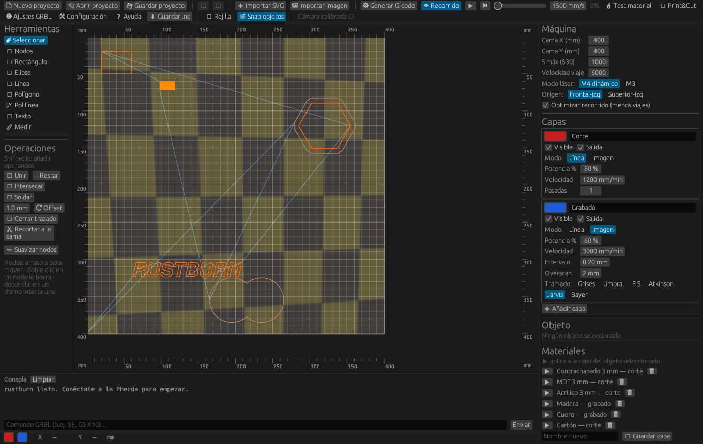
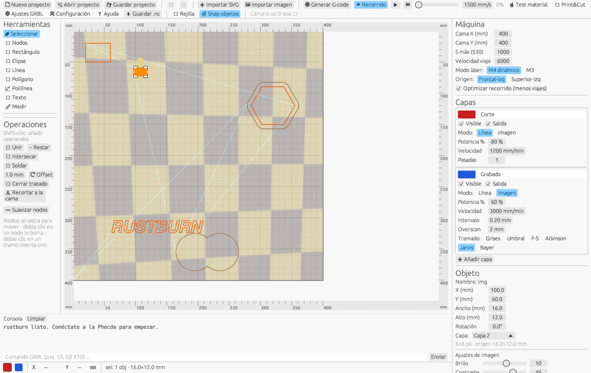

# rustburn

**Español** · [English](README.en.md)

Aplicación nativa en **Rust** para **Linux** de diseño y control de láser, al estilo
**LightBurn**, pensada para láseres de diodo con firmware **GRBL 1.1** como la
**Elegoo Phecda 20 W**. Un solo binario, sin dependencias de tiempo de ejecución,
sin licencia: **software libre**.

Interfaz inmediata con **egui/eframe**, lienzo propio, y toda la E/S del dispositivo
en un hilo de fondo para que la UI nunca se bloquee.



Fondo claro opcional (toda la interfaz):



---

## Características

### Diseño y lienzo
- Lienzo con **zoom/pan**, **rejilla de 10 mm**, **reglas en los 4 lados** y límites de cama.
- **Snap** a la cuadrícula y **snap a objetos** (bordes/centros) con guías.
- **Fondo claro u oscuro** conmutable (toda la interfaz).
- Herramientas de dibujo: **Rectángulo, Elipse, Línea, Polígono, Polilínea, Texto** y **Medir**.
- **Texto vectorial** con **selector de la fuente instalada** en el equipo (y fuente DejaVu
  Sans empotrada como respaldo infalible), altura en mm y **numeración / texto variable**
  en serie (`#`, `###` como hueco del número).
- **Edición de nodos**: arrastrar, insertar (doble clic en un tramo) y borrar (doble clic en
  un nodo), más **suavizado** de nodos (spline Catmull-Rom).

### Importación y vectorizado
- **SVG** (trazos vectoriales, curvas aplanadas a tolerancia).
- **Imágenes** PNG / JPG / **WebP** / BMP / GIF, convertidas a **escala de grises**.
- **PDF**, con dos modos (menú «Importar PDF»):
  - **Como vectores** (corte): convierte los trazos de la 1ª página a vectores
    (`pdftocairo -svg` / `inkscape`) y los importa como trazados.
  - **Como imagen** (grabado): rasteriza la 1ª página (poppler / ghostscript); luego
    se puede grabar o **vectorizar** a contornos.
- Todo lo importado llega **ajustado y centrado en la cama** y es **reescalable**
  (tiradores en las esquinas al seleccionar, o campos Ancho/Alto en el panel Objeto).
- **Vectorizar bitmap** (trazado de imagen a contornos): marching squares + simplificación
  Douglas–Peucker, con umbral, suavizado e inversión.

### Operaciones
- **Booleanas**: Unir, Restar, Intersecar.
- **Soldar**, **Offset** (contorno interior/exterior), **Cerrar trazado**, **Recortar a la cama**.
- **Organizar**: Agrupar/Desagrupar, Espejo H/V, Rotar 90°, Alinear (6 direcciones),
  **Distribuir H/V** y **Matriz/Array** (rejilla cols×filas o circular).

### Capas y grabado de imagen
- **Capas** con color, modo **Línea** (corte/trazo) o **Imagen** (grabado raster),
  potencia %, potencia mínima, velocidad, pasadas, intervalo de línea y overscan.
- **Tramados** para grabado: Escala de grises, Umbral, **Floyd–Steinberg**, **Atkinson**,
  **Jarvis–Judice–Ninke** y **Bayer** ordenado.
- **Ajustes de imagen**: brillo, contraste, gamma e inversión.

### G-code (GRBL)
- **Corte vectorial** con modo láser **M4 dinámico** o **M3 constante**, `S` escalada a
  potencia % y `F` por velocidad; múltiples pasadas.
- **Grabado raster** por líneas bidireccionales con overscan y potencia modulada por píxel.
- **Origen de trabajo de 9 puntos** y opción de **cortar solo los objetos seleccionados**.
- **Optimización del recorrido** (reordena cortes para minimizar viajes).
- **Simulación del recorrido** con reproducción ▶/⏸/⏮, velocidad y **tiempo estimado**.
- Exportación a archivo **`.nc`** (también `.gcode`).

### Cámara y alineación
- **Captura de cámara USB** (vía `ffmpeg`, sin dependencias nativas de v4l).
- **Alineación por foto** (homografía de 4 puntos) para colocar el diseño sobre el material.
- **Corrección de distorsión de lente** (modelo radial k1/k2).
- **Print & Cut** con **marcas de registro** y ajuste afín (similitud con 2 puntos o mínimos
  cuadrados con 3+), para cortar sobre una impresión existente.

### Máquina y conexión
- **Conexión USB (serie)** y **WiFi (TCP)**; protocolo GRBL por **conteo de caracteres**
  (streaming fiable), estado en vivo (`?`), consola y jog.
- **Jog / Home / fijar origen**, **encuadre** del contorno a baja potencia, **pausa** (`!`),
  **reanudar** (`~`) y **parada** (soft-reset `0x18`), con barra de progreso.
- **Ajustes de máquina**: tamaño de cama X/Y, S máx (`$30`), baudios, velocidad de viaje,
  modo láser y origen; **presets** de máquinas comunes y **"Mis láseres"** (guardar la
  configuración actual como un perfil propio).
- Lectura/edición de **ajustes GRBL `$$`**.
- **Biblioteca de materiales** (presets de corte/grabado) y **test de material** (rejilla
  de potencia×velocidad).

### Comodidades
- **Nuevo proyecto**, **Guardar/Abrir** proyecto (`.rbp`, JSON), **deshacer/rehacer**.
- **Persistencia de preferencias** entre sesiones: última máquina, fondo (claro/oscuro) y
  fuente de texto (`~/.config/rustburn/prefs.json`).
- **Renderizado por software automático** si la GPU no soporta OpenGL 3.x (p. ej. equipos
  antiguos con Intel GMA / OpenGL 2.1); se detecta al arrancar y se activa `llvmpipe` sin
  intervención.

---

## Compilar y ejecutar

Requiere un toolchain de Rust reciente.

```bash
cargo run --release
```

Autocomprobación sin interfaz (construye un documento de ejemplo, valida G-code, trazado,
texto, preferencias, etc.):

```bash
cargo run -- --selftest
```

### AppImage (sin FUSE)

```bash
bash packaging/build-appimage.sh
./dist/rustburn-x86_64.AppImage
# o, si el sistema no tiene FUSE:
./dist/rustburn-x86_64.AppImage --appimage-extract-and-run
```

> **GPU antigua / pantalla negra**: rustburn detecta OpenGL < 3.0 y cae a renderizado por
> software automáticamente. Para forzarlo tú mismo: `LIBGL_ALWAYS_SOFTWARE=1 ./rustburn...`.
> Para desactivar la detección automática: `RUSTBURN_NO_GL_FALLBACK=1`.

---

## Conectar la Elegoo Phecda

- **USB**: suele aparecer como `/dev/ttyUSB0` (115200 baudios). Si no tienes permiso para
  abrir el puerto, añade tu usuario al grupo `dialout` y reinicia sesión:
  ```bash
  sudo usermod -aG dialout $USER
  ```
- **WiFi**: introduce la IP de la Phecda y el puerto TCP.

La cámara USB en vivo usa `ffmpeg` (dispositivo editable, por defecto `/dev/video0`).

---

## Seguridad

Comprueba siempre potencia/velocidad y haz **encuadre** antes de cortar. Usa gafas de
protección adecuadas para láser de 20 W, ventilación/extracción y vigilancia constante.
El **origen** y el **tamaño de cama** deben coincidir con tu máquina (panel **Configuración**).
Los presets de materiales son orientativos: **verifica siempre** con pruebas.

---

## Colaboradores

- **Epi** — tester (`epi@tudela.com`)

---

## Licencia

MIT OR Apache-2.0.
